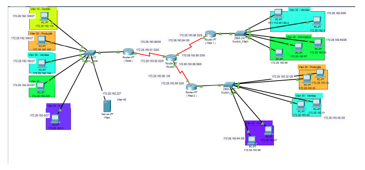

# Computer Networks — Cisco Packet Tracer

Academic project developed for the **Computer Networks** course during the 2023/2024 academic year.

The project consists of the planning and simulation of a network for a fictional company with a headquarters and two branch offices. It was originally developed as a **group academic project**.

## Network topology



## Main topics

- IPv4 addressing and subnetting
- VLSM-based address planning
- VLAN segmentation
- IEEE 802.1Q trunking
- Router-on-a-Stick using router subinterfaces
- Dynamic routing with RIP version 2
- Inter-VLAN and inter-site connectivity
- Cisco router and switch configuration
- Network simulation and connectivity testing with Cisco Packet Tracer

## Scenario

The simulated company contains three locations:

| Location | Initial equipment requirement | Requirement with 15% growth |
| --- | ---: | ---: |
| Headquarters | 125 | 144 |
| Branch 1 | 75 | 87 |
| Branch 2 | 15 | 18 |

The network is divided by functional area using VLANs for:

- Management
- Production
- Sales
- IT
- Human Resources

The addressing plan was derived from the assigned `172.28.231.236/18` address, resulting in the base network `172.28.192.0/18`.

Point-to-point router links use `/30` networks, while the LANs are divided according to the requirements of each location and department.

## Repository structure

```text
.
├── assets/
│   └── network-topology.png
├── configs/
│   └── RC_Configs.txt
├── packet-tracer/
│   └── TrabalhoRC.pkt
├── .gitignore
└── README.md
```

## Files

### `packet-tracer/TrabalhoRC.pkt`

Original Cisco Packet Tracer simulation containing the network topology and device configuration.

### `configs/RC_Configs.txt`

Configuration commands used for the switches and routers, including VLANs, access/trunk ports, router subinterfaces and RIP v2.

## Opening the project

1. Install **Cisco Packet Tracer**.
2. Open `packet-tracer/TrabalhoRC.pkt`.
3. Inspect the routers, switches, VLANs and end devices.
4. Use Packet Tracer simulation/testing tools to verify connectivity.

## Notes

This repository preserves the practical implementation substantially as it was produced for the original academic assignment. The repository layout and documentation were cleaned up later for portfolio presentation.
